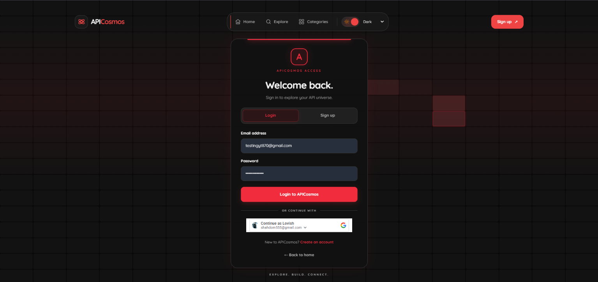
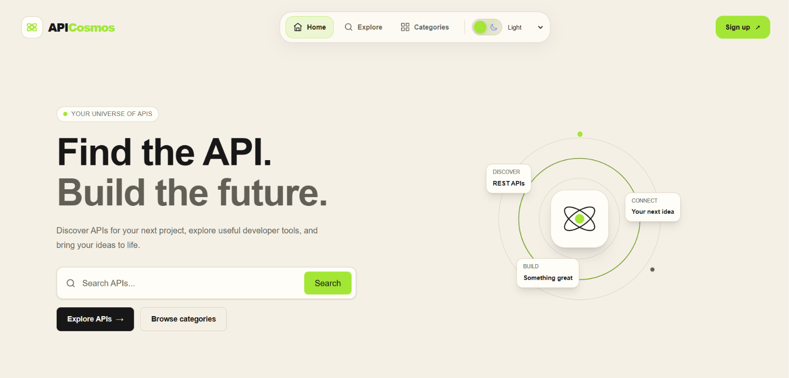
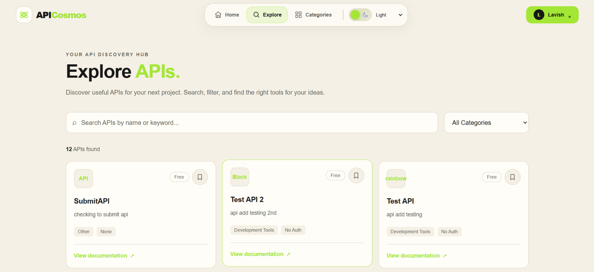

# 🪐 APICosmos — Explore the Universe of APIs

<p align="center">
  
  
  
  
  
  
</p>

<p align="center">
  <strong>A full-stack API discovery and management platform built with the MERN ecosystem and Next.js.</strong>
  <br />
  Discover APIs, explore categories, submit your own APIs, and manage an API directory through a dedicated administration dashboard.
</p>

<p align="center">
  <a href="https://api-cosmos-phi.vercel.app/"><strong>🌐 Live Demo</strong></a>
  &nbsp; • &nbsp;
  <a href="https://github.com/Lavish870/APICosmos"><strong>💻 Source Code</strong></a>
  &nbsp; • &nbsp;
  <a href="https://apicosmos-olyx.onrender.com"><strong>⚙️ Backend</strong></a>
</p>

---

## 🌌 About APICosmos

APICosmos is a full-stack web application designed to make discovering and managing APIs easier.

The platform brings an API directory, user authentication, community submissions, and administrative moderation together in one place.

Users can explore available APIs, discover them by category, save their favourites, and contribute new API listings. Administrators can review submissions, manage users, and maintain the platform through a dedicated dashboard.

**The idea:** Build more than a simple API listing website. Create a complete application with authentication, database integration, role-based access, and a polished user experience.

## 🎨 Design Philosophy — Two Sides of the Omnitrix

APICosmos draws its visual identity from the **Ben 10 universe**, bringing two contrasting sides of the Omnitrix into a modern developer platform.

- 💚 **Light Mode — The Hero:** Inspired by Ben Tennyson's iconic green Omnitrix, combining vibrant green, white, and black for a clean, energetic interface.
- ❤️ **Dark Mode — The Villain:** Inspired by the villainous, red Omnitrix aesthetic from the Ben 10 universe, featuring striking red accents against deep black backgrounds.

**Two themes. Two identities. One universe.**

Rather than simply switching between light and dark colours, APICosmos uses its themes to express two distinct personalities inspired by the same fictional universe.

## 🔐 Authentication Experience

The authentication page is one of the central visual features of APICosmos.

It brings together a clean interface, custom styling, and multiple ways to access an account.

**Authentication features:**
- Email and password registration.
- Email and password login.
- Google sign-in integration.
- JWT-based authentication.
- Role-aware navigation for users and administrators.
- Loading and error feedback.

<p align="center">
  
</p>

<p align="center">
  <em>A dedicated authentication experience with APICosmos' red-and-black dark theme.</em>
</p>

## ✨ Features

### 🔎 API Discovery
- Browse the API directory.
- Explore APIs by name.
- Discover APIs through categories.
- View API information and details.

### 👤 User Accounts
- Create an account and sign in.
- Authenticate using Google.
- Access protected features through JWT authentication.
- Role-aware navigation.

### 📦 API Contributions
- Submit new APIs to the directory.
- Track your own submissions.
- Update your submitted APIs.
- Delete your own submissions.
- Submissions begin in a pending state for administrative review.

### ❤️ Personalisation
- Save favourite APIs.
- Keep track of recently viewed APIs.
- Store saved and recently viewed items in browser local storage.

### 🛡️ Administration Dashboard
- View platform statistics.
- Monitor total, pending, approved, and rejected APIs.
- View registered users and submission counts.
- Review and approve API submissions.
- Reject or delete API listings.
- Manage the API directory.

## 🖥️ Screenshots

A look at the APICosmos experience.

### 01 — Homepage

<p align="center">
  
</p>

*The Ben 10-inspired green, white, and black visual identity.*

### 02 — Authentication

<p align="center">
  
</p>

*The red-and-black login experience.*

### 03 — Explore APIs

<p align="center">
  
</p>

*Discover and explore APIs through the directory.*

### 04 — Admin Dashboard

<p align="center">
  
</p>

*Platform insights and API moderation in one place.*

## 🧰 Technology Stack

### Frontend

| Technology | Purpose |
|---|---|
|  Next.js 16 | React framework and application routing |
|  React 19 | Component-based UI |
|  Tailwind CSS 4 | Styling and interface design |
|  Google OAuth | Google sign-in integration |

### Backend

| Technology | Purpose |
|---|---|
|  Node.js | JavaScript runtime |
|  Express 5 | REST API and server-side routing |
|  MongoDB | Database |
|  Mongoose | MongoDB object modelling |
|  JSON Web Tokens | Authentication |
| Google Auth Library | Google credential verification |

### Deployment

| Platform | Responsibility |
|---|---|
|  Vercel | Frontend hosting |
|  Render | Backend hosting |

## 🏗️ Project Architecture

APICosmos uses a separate frontend and backend architecture.

```text
APICosmos/
│
├── frontend/
│   ├── public/
│   ├── src/
│   │   ├── app/
│   │   ├── components/
│   │   └── ...
│   ├── package.json
│   └── ...
│
├── backend/
│   ├── models/
│   ├── routes/
│   ├── middleware/
│   ├── index.js
│   └── package.json
│
├── docs/
│   └── screenshots/
│       ├── homepage.png
│       ├── login.png
│       ├── explore.png
│       └── dashboard.png
│
└── README.md
```

*The structure above is a simplified overview of the project.*

## 🔄 How It Works

The application follows a client-server architecture:

1. The Next.js frontend provides the user interface.
2. The frontend communicates with the Express backend through HTTP requests.
3. Express handles authentication, API operations, and administrative requests.
4. MongoDB stores application data.
5. JWT authentication protects authorised routes.
6. Google credentials are verified through the Google authentication library.
7. Role-based access separates standard user functionality from administration.

## 🔌 REST API Reference

The backend exposes REST endpoints under `/api`.

### Authentication — `/api/auth`

| Method | Endpoint | Description | Access |
|---|---|---|---|
| POST | `/api/auth/signup` | Register a new account | Public |
| POST | `/api/auth/login` | Authenticate with email and password | Public |
| POST | `/api/auth/google` | Authenticate with Google | Public |
| GET | `/api/auth/me` | Get current authenticated user | Authenticated |

### API Directory — `/api/apis`

| Method | Endpoint | Description | Access |
|---|---|---|---|
| GET | `/api/apis` | Retrieve API listings | Public |
| GET | `/api/apis/name/:name` | Retrieve an API by name | Public |
| GET | `/api/apis/mine` | Retrieve your submissions | Authenticated |
| POST | `/api/apis` | Submit a new API | Authenticated |
| PUT | `/api/apis/:id` | Update your submission | Owner |
| DELETE | `/api/apis/:id` | Delete your submission | Owner |

### Administration — `/api/admin`

| Method | Endpoint | Description | Access |
|---|---|---|---|
| GET | `/api/admin/stats` | Retrieve dashboard statistics | Admin |
| GET | `/api/admin/apis` | Retrieve APIs for moderation | Admin |
| PATCH | `/api/admin/apis/:id/status` | Update API approval status | Admin |
| DELETE | `/api/admin/apis/:id` | Delete an API listing | Admin |
| GET | `/api/admin/users` | Retrieve registered users | Admin |

## ⚙️ Run Locally

Want to explore the project or run your own instance? Follow these steps.

### Prerequisites

Make sure you have:

- [Node.js](https://nodejs.org/) installed.
- npm installed.
- A [MongoDB](https://www.mongodb.com/) database.
- A Google OAuth Client ID if you want to enable Google sign-in.

### 1. Clone the repository

```bash
git clone https://github.com/Lavish870/APICosmos.git
cd APICosmos
```

### 2. Set up the backend

```bash
cd backend
npm install
```

Create a `.env` file inside the `backend` directory:

```env
PORT=5000
MONGODB_URI=your_mongodb_connection_string
JWT_SECRET=your_jwt_secret
GOOGLE_CLIENT_ID=your_google_client_id
```

Use the environment variable names expected by your backend configuration.

Start the backend:

```bash
npm run dev
```

The backend should now be available at:

```text
http://localhost:5000
```

### 3. Set up the frontend

Open another terminal:

```bash
cd frontend
npm install
```

Create a `.env.local` file inside the `frontend` directory:

```env
NEXT_PUBLIC_API_URL=http://localhost:5000
NEXT_PUBLIC_GOOGLE_CLIENT_ID=your_google_client_id
```

Use the same Google OAuth client configuration for the frontend and backend where required.

Start the frontend:

```bash
npm run dev
```

Open:

```text
http://localhost:3000
```

### 4. You're ready!

Your local frontend and backend should now be running separately.

**Note:** Keep your credentials private. Never commit `.env` or `.env.local` files to GitHub.

## ☁️ Deployment

APICosmos is deployed using separate hosting services for the frontend and backend.

| Component | Deployment |
|---|---|
| Frontend | [Vercel](https://vercel.com/) |
| Backend | [Render](https://render.com/) |
| Database | MongoDB |

### Live Application

- **Frontend:** https://api-cosmos-phi.vercel.app/
- **Backend:** https://apicosmos-olyx.onrender.com

For a separate deployment, configure the frontend API URL, backend environment variables, Google OAuth authorised origins, and CORS settings to match your own deployment domains.

## 🧠 What I Learned

APICosmos was built as an academic minor project and a practical learning experience while exploring full-stack development.

Working on it helped me understand:

- Building a full-stack application with Next.js and Express.
- Designing and connecting REST APIs.
- Integrating MongoDB using Mongoose.
- Implementing JWT-based authentication.
- Integrating Google OAuth.
- Managing user roles and protected routes.
- Building an administrative dashboard.
- Connecting a separately deployed frontend and backend.
- Working with environment variables and deployment configuration.
- Creating a consistent visual identity across an application.

## 🚀 Future Improvements

Some ideas for taking APICosmos further:

- Password hashing and stronger authentication security.
- Improved input validation and API request protection.
- API search, filtering, and pagination enhancements.
- API testing and availability monitoring.
- More detailed API documentation.
- Improved error handling and automated testing.
- Additional dashboard analytics.

## 👨‍💻 Developer

<p align="center">
  <strong>Lavish Sharma</strong>
  <br />
  Developer • UI/UX Enthusiast • Gamer • Tech Explorer
  <br /><br />
  <a href="https://github.com/Lavish870">
    
  </a>
  <a href="https://github.com/Lavish870/APICosmos">
    
  </a>
</p>

---

<p align="center">
  <strong>Built with curiosity, code, and a little bit of cosmic energy. ✨</strong>
  <br />
  <sub>APICosmos — An academic project and a step further into full-stack development.</sub>
</p>
